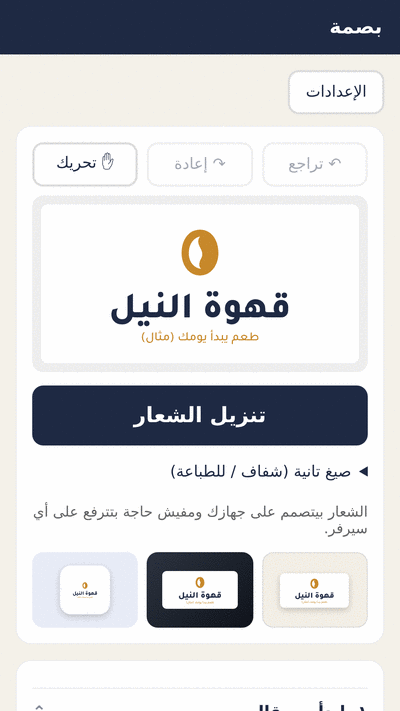
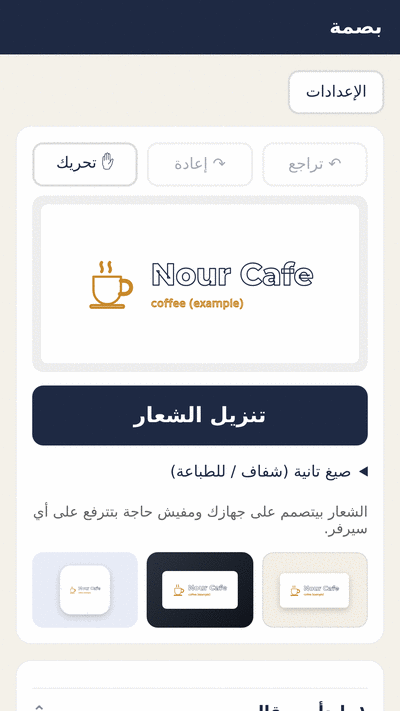
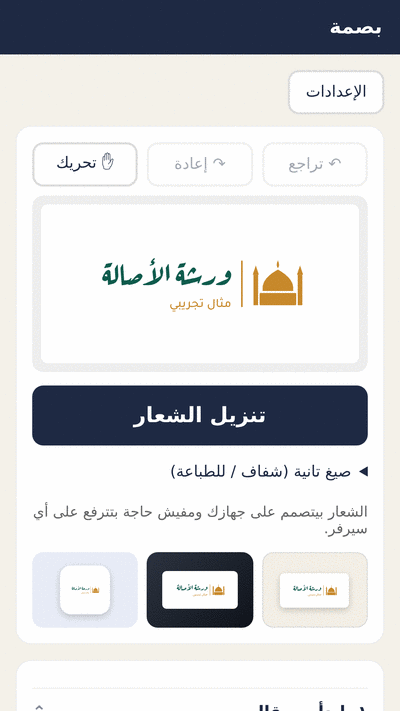
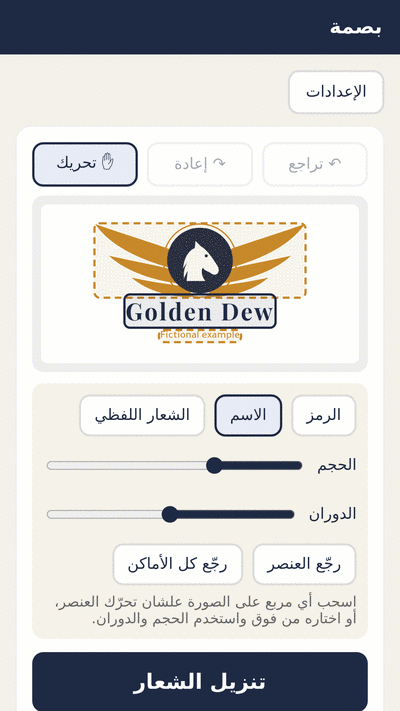

# بصمة | Basma

**العربية** | [English](#english)

بصمة تطبيق أندرويد بسيط تصمّم بيه شعار لمشروعك في دقايق، من غير خبرة في التصميم.
اكتب اسم النشاط (عربي أو English)، اختار الرمز والخط والألوان، والشعار يتغير قدامك على طول. حمّله PNG أو SVG.

### المميزات
- أكتر من 80 رمز، و12 خط عربي وإنجليزي (منهم خط مخطوطة وكوفي)
- 11 تخطيط و5 أساليب (عادي، بحدود، مرسوم باليد، ظل، وذهبي معدني)
- قوالب وألوان جاهزة وألوانك انت
- حرّك الرمز والاسم والشعار اللفظي كل واحد لوحده، مع تراجع وإعادة
- معاينة على كارت ولوحة داكنة وأيقونة تطبيق
- تنزيل PNG بخلفية بيضاء أو شفافة، أو SVG للطباعة

### التثبيت
1. نزّل ملف الـAPK من صفحة Releases.
2. لما أندرويد يسأل، اسمح بالتثبيت من المصدر ده، وافتح الملف.
3. ممكن Google Play Protect يحذّر من مطوّر غير معروف، لأن التطبيق مش من متجر Play.

يشتغل على أندرويد 7.0 أو أحدث. اسم الحزمة: `com.mahmoud.basma`. الإصدار الحالي 1.5.3 (قيد التطوير).

### ملاحظات
- الشعارات بتتعمل من قوالب جاهزة جوّه التطبيق، مش بالذكاء الاصطناعي.
- التصميم والحفظ بيتم على جهازك. مفيش حساب ولا إعلانات.
- التصاميم المحفوظة بتتخزن على جهازك (لحد 12 تصميم). ممكن النسخ الاحتياطي بتاع أندرويد يحفظ بيانات التطبيق مع نسختك الاحتياطية، ولو مش عايز كده اقفله من إعدادات الهاتف.
- الأمثلة في الصور تخيلية.

  
  

---

## English

Basma is a simple Android app for making a logo for your business in minutes, with no design experience.
Type your business name (Arabic or English), pick a symbol, font and colors, and watch the logo change as you go. Export PNG or SVG.

### Features
- 80+ symbols and 12 Arabic and Latin fonts, including calligraphy and Kufi
- 11 layouts and 5 styles (solid, outline, hand-drawn, shadow, metallic gold)
- Ready-made templates and color palettes, or your own colors
- Move, resize and rotate the symbol, name and tagline separately, with undo and redo
- Mockup previews: business card, dark sign, app icon
- Export PNG (white or transparent background) or SVG for print

### Install
1. Download the APK from the Releases page.
2. When Android asks, allow installs from this source, then open the file.
3. Google Play Protect may warn about an unknown developer, because the app is not from the Play Store.

Works on Android 7.0 and later. Package name: `com.mahmoud.basma`. Current version 1.5.3 (in development).

### Good to know
- Logos are built from templates inside the app, not by AI.
- Designing and saving happen on your device. No account, no ads.
- Saved designs (up to 12) are stored on your device. Android's backup feature may include the app's data in your phone backup. Turn that off in your phone settings if you don't want it.
- The example logos in the screenshots are fictional.

### Verify the download
SHA-256 of the APK: `619dc268c2cb9b0beb1f42750cc32868d2c337b9181d3c0d04973b09cdf64ed7`
Signing certificate SHA-256: `7771a3aef926425238aff65670db65c1eeb2e77bf197e2d516230254cdd5fb04`
